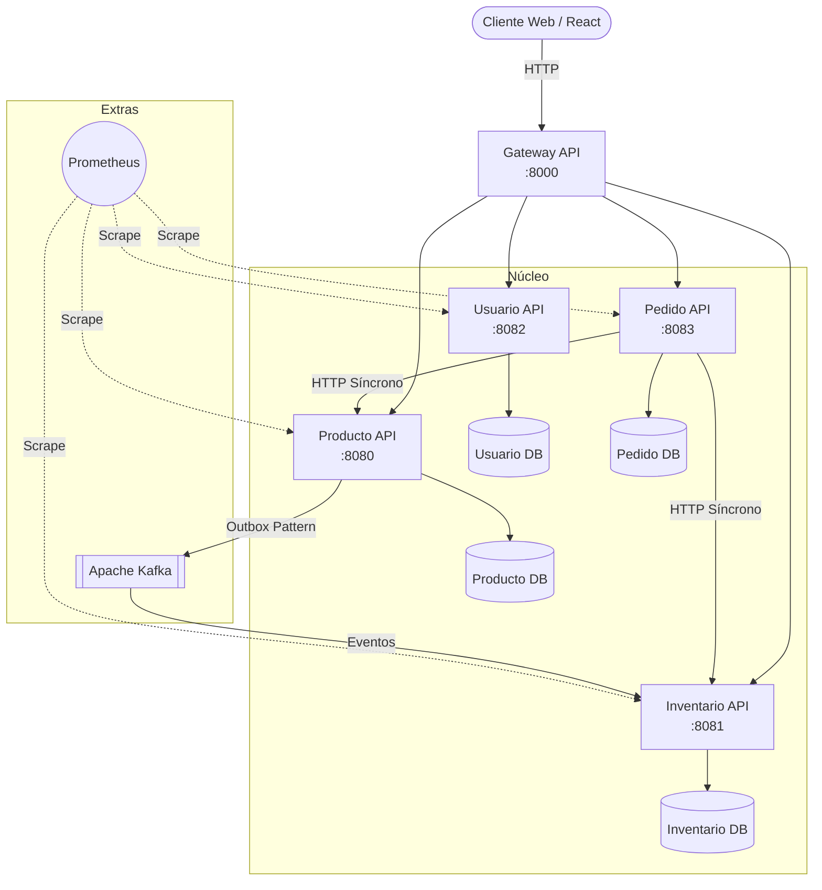

# E-Commerce Microservices Portfolio 

[](https://github.com/DanielMelejPinto/e-commerce/actions/workflows/ci.yml)
[](https://github.com/DanielMelejPinto/e-commerce/actions/workflows/frontend-ci.yml)


Plataforma de comercio electrónico *full-stack* compuesta por cinco microservicios en **Java 21** con **Spring Boot 4.1.1** y una aplicación web SPA en **React 19**, **TypeScript** y **Vite**.

El sistema implementa autenticación stateless con JWT, enrutamiento centralizado mediante un API Gateway, sincronización asíncrona de catálogo e inventario con el patrón Transactional Outbox sobre Apache Kafka, creación y cancelación de pedidos mediante una saga síncrona con Circuit Breaker (Resilience4j) e idempotencia en base de datos, migraciones versionadas con Flyway sobre PostgreSQL 17 y despliegue local mediante Docker Compose.

## Arquitectura



### Servicios Core (Núcleo)
1. **`gateway-api` (Puerto 8000)**: API Gateway (Spring Cloud Gateway) que centraliza el enrutamiento, CORS y simplifica el acceso.
2. **`usuario-api` (Puerto 8082)**: Gestión de identidades, roles (USER, ADMIN) y validación JWT.
3. **`producto-api` (Puerto 8080)**: Catálogo de productos. 
4. **`inventario-api` (Puerto 8081)**: Gestión de stock. Maneja concurrencia de reposición mediante **Optimistic Locking** (`@Version`). Implementa reservas duraderas e idempotentes.
5. **`pedido-api` (Puerto 8083)**: Orquestador central de la **Saga Síncrona**. Controla idempotencia a nivel atómico para evitar cargos duplicados.

### Componentes de Soporte (Extras)
- **Apache Kafka + Patrón Outbox (ShedLock)**: Propaga eventos de creación de productos de `producto-api` a `inventario-api` de forma resiliente para inicializar el stock. Incluye un DLT (Dead Letter Topic) y reprocesamiento en lotes para tolerancia a fallos.
- **Circuit Breaker (Resilience4j)**: Protege a `pedido-api` para reaccionar con Fail-Fast si un servicio dependiente está caído.
- **Prometheus**: Recolección de métricas a través de Spring Boot Actuator.

## Decisiones de Diseño

1. **Carrera de Cancelación de Pedidos**: Al cancelar un pedido concurrentemente, existía el riesgo de liberar el stock múltiples veces si la lectura del estado `CONFIRMADO` y el guardado `CANCELADO` se solapaban. 
   - *Por qué no `@Version`:* El `@Version` en `Pedido` evitaría sobreescribir el estado, pero la excepción saldría *después* de que la llamada a la API externa de inventario ya hubiera liberado el stock.
   - *Solución implementada:* Se utiliza un `UPDATE` condicional atómico (`UPDATE Pedido p SET p.estado = CANCELADO WHERE p.id = :id AND p.estado = CONFIRMADO`). El inventario usa identificadores únicos de reserva vinculados al ID del pedido para garantizar operaciones puramente idempotentes, resolviendo inconsistencias si una solicitud externa falla en su respuesta.
2. **Idempotencia Atómica**: La API de pedidos previene cobros y efectos duplicados mediante `Idempotency-Key` atada atómicamente a la creación del pedido. La clave primaria de la tabla de idempotencia es compuesta (`usuario_id, clave`), bloqueando múltiples requests en curso que compartan clave antes de tocar dependencias externas.
3. **Resiliencia con Kafka**: Para la asincronía eventual en la creación de stock base, se procesa Outbox en lotes y cualquier error del consumidor se envía a un DLT de Kafka (`DeadLetterPublishingRecoverer`), con endpoints administrativos para su reintento y persistencia nativa en disco con Docker Volumes.

## Cómo ejecutar el proyecto en local

Puedes levantar absolutamente todo (PostgreSQL, Kafka, métricas, frontend y backend) con un solo comando:

```bash
cp .env.example .env
docker compose up -d --build
```
Una vez que los contenedores estén `healthy`, accede a `http://localhost:5173`. Para apagar: `docker compose down`.

> **⚠️ IMPORTANTE - Entornos y Seguridad:**
> - El archivo `.env` controla los secretos de BD y JWT del entorno productivo/docker. **Si falta la variable de BD, el compose fallará.**
> - El perfil `dev` de Spring Boot utiliza una base de datos H2 en memoria, y expone credenciales hardcodeadas (como `admin123`) y un secreto JWT débil. Estas credenciales **SOLO son válidas y funcionan bajo el perfil `dev`** y nunca en el despliegue Docker/PostgreSQL.

## Migraciones de base de datos

Los cuatro microservicios con persistencia (`usuario-api`, `producto-api`, `inventario-api` y `pedido-api`) gestionan su esquema mediante **Flyway** (`spring-boot-starter-flyway` y `flyway-database-postgresql`), con 14 scripts SQL versionados en `src/main/resources/db/migration/`:

- **`usuario-api` (1 migración):** `V1__init.sql` (tabla `usuarios`).
- **`producto-api` (4 migraciones):** `V1__init.sql` a `V4__ampliar_precio.sql` (tablas `producto`, `outbox_events` y `shedlock`).
- **`inventario-api` (3 migraciones):** `V1__init.sql` a `V3__reserva_estado.sql` (tablas `inventarios` y `reservas`).
- **`pedido-api` (6 migraciones):** `V1__init.sql` a `V6__ampliar_total.sql` (tablas `pedidos`, `pedido_items` y `claves_idempotencia`).

## Pruebas

El repositorio cuenta con **155 pruebas automatizadas** (72 unitarias y 83 de integración) repartidas entre los módulos de backend y el frontend, además de un script de pruebas E2E (`scripts/e2e.sh`) con **21 verificaciones** sobre el flujo completo:

| Módulo | Unitarias | Integración | Total | Detalles |
|---|---:|---:|---:|---|
| `gateway-api` | 0 | 2 | **2** | `@SpringBootTest` (`RouteLocator`) |
| `usuario-api` | 9 | 28 | **37** | JUnit 5, Mockito, `@DataJpaTest`, `MockMvc` |
| `producto-api` | 20 | 31 | **51** | JUnit 5, Mockito, `MockMvc`, OpenAPI |
| `inventario-api` | 19 | 17 | **36** | Mockito, `MockMvc`, Testcontainers (PostgreSQL) |
| `pedido-api` | 19 | 5 | **24** | Mockito, Bean Validation, `@SpringBootTest` |
| `frontend-app` | 5 | 0 | **5** | Vitest (`useCartStore`) |
| **Total** | **72** | **83** | **155** | |

> **Nota sobre Testcontainers:** En `inventario-api`, 16 pruebas de integración (`InventarioControllerTest` e `InventarioApiApplicationTests`) utilizan `@Testcontainers(disabledWithoutDocker = true)`. Si Docker no está en ejecución localmente, Maven las omite (`Skipped: 16`) y ejecuta las 20 restantes; con Docker activo (o en GitHub Actions) se ejecutan las 36. No hay herramienta de cobertura (como JaCoCo) configurada en el proyecto.

### Cómo ejecutar las pruebas

```bash
# Pruebas de cada microservicio backend
cd gateway-api && ./mvnw test
cd usuario-api && ./mvnw test
cd producto-api && ./mvnw test
cd inventario-api && ./mvnw test
cd pedido-api && ./mvnw test

# Pruebas unitarias del frontend
cd frontend-app && npm test

# Pruebas E2E (requiere tener el entorno levantado con docker compose up -d)
./scripts/e2e.sh
```

## CI/CD

El repositorio utiliza **GitHub Actions** con dos flujos de integración continua en `.github/workflows/`:

- **Backend CI (`ci.yml`):** Se ejecuta en cada `push` o `pull_request` hacia `main`. Levanta una matriz en `ubuntu-24.04` con JDK 21 (Temurin) y ejecuta `./mvnw -B verify` de forma paralela para `gateway-api`, `producto-api`, `inventario-api`, `usuario-api` y `pedido-api`.
- **Frontend CI (`frontend-ci.yml`):** Se ejecuta ante cambios en `frontend-app/**` sobre `main` o `develop` con Node.js 20, corriendo `npm ci`, linting con Oxlint (`npm run lint`), pruebas con Vitest (`npm run test`) y compilación de producción (`npm run build`).

---
**Autor:** [Daniel Melej Pinto](https://github.com/DanielMelejPinto)
